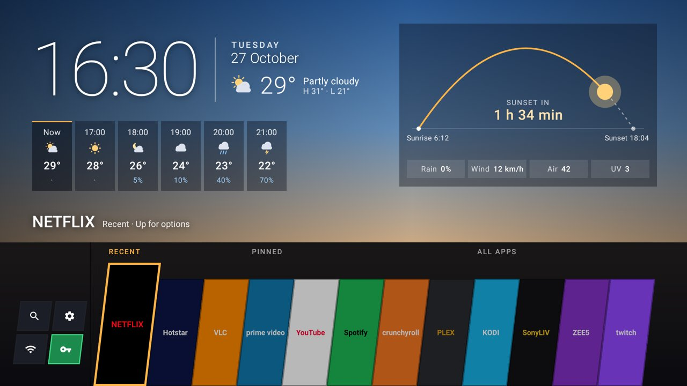
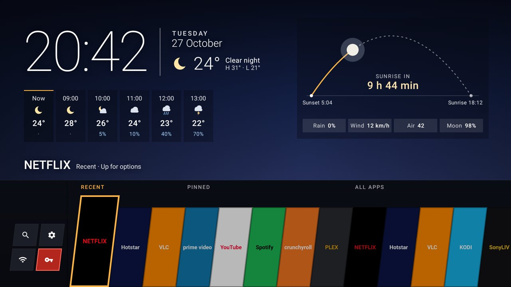
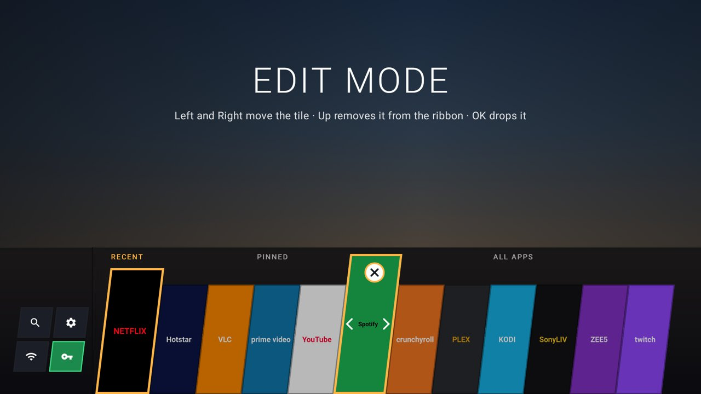
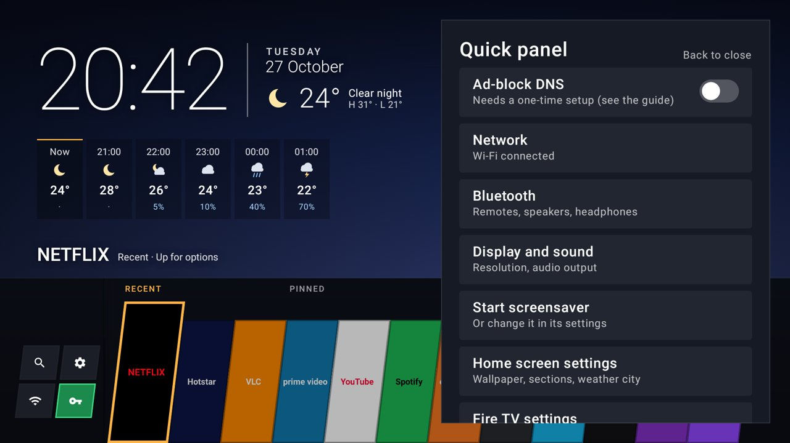

# Firebolt Home: a fork of Couchy Launcher

This folder is [Couchy Launcher](https://github.com/conreo/couchy-launcher), upstream commit in `UPSTREAM_COMMIT`,
licensed GPLv3 (`LICENSE`, `LICENSING.md`). If you share a build, share this source with it.

Changes from upstream so far:

- `applicationId` is `io.github.firebolt141.home`, so it installs next to Couchy. The Kotlin package stays
  `com.conreo.couchytv` so upstream fixes merge with little conflict.
- App name "Firebolt Home" (working name: `app_name` in `app/src/main/res/values*/strings.xml`), version `0.1.0`.
- The setup wizard's `set-home-activity` hint uses the app's own package instead of Couchy's.
- Removed upstream's F-Droid metadata and release workflow; this repo builds with `.github/workflows/launcher-apk.yml`.
- New: the ribbon home (`ui/RibbonHome.kt`, `ui/QuickPanel.kt`, `data/RibbonOrder.kt`, `data/Weather.kt`,
  `data/SystemSwitches.kt`), a brand colour per app (`AppRepository.edgeColor`), an amber accent, and
  `WRITE_SECURE_SETTINGS` for the Quick panel's DNS switch (granted over ADB by `scripts/launcher.sh setup`).

## The ribbon home (layout 3, default)






Rendered off-device by `./gradlew recordRoborazziDebug` (sample apps and weather). The same run executes the
logic and remote-key tests; CI runs it on every launcher change (`.github/workflows/launcher-tests.yml`).

## Building (not done yet)

1. Once: `scripts/launcher-keystore.sh`, then add the four secrets it prints to GitHub.
2. GitHub: Actions > launcher-apk > Run workflow, download the `firebolt-home-apk` artifact.
   Or locally, with JDK 17 + Android SDK: `scripts/build-launcher.sh`.
3. `TV_HOST=<ip> LAUNCHER=firebolt scripts/launcher.sh setup firebolt-home-<version>.apk`, pick Firebolt Home as
   the target in Home on Fire. Couchy can stay installed as a fallback.

## Pulling upstream changes

```sh
git clone https://github.com/conreo/couchy-launcher /tmp/couchy && cd /tmp/couchy
git diff $(cat <repo>/launcher/UPSTREAM_COMMIT) HEAD -- app > /tmp/couchy.patch
cd <repo>/launcher && git apply -3 /tmp/couchy.patch    # then update UPSTREAM_COMMIT
```
